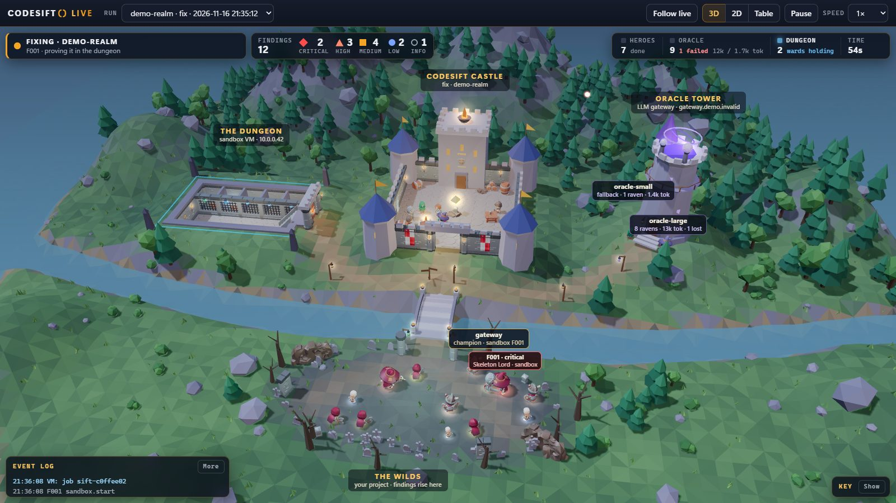

# CodeSift

[](https://github.com/PersianGru/CodeSift/actions/workflows/ci.yml)

CodeSift is one command that runs free, open-source security scanners (gitleaks, osv-scanner, trivy,
opengrep, ruff/bandit, pip-audit, zizmor, …) on any code project, has a model behind **your
OpenAI-compatible LLM gateway** triage the findings, and writes a **short `summary.md`** that a person
or an AI assistant can read cheaply.

Since 0.2.0 there is a second half: **prove fixes**. `sift fix` lets AI fixers (a model through your
LLM gateway, the Claude CLI or the Claude API) propose patches. Then deterministic checks decide
whether a patch works: a mechanical patch policy, your project's tests and proofs of concept run in a
**disposable, network-less container on a separate sandbox VM**, and a re-scan. The output is a
patch for you to review. Nothing is ever applied, merged or pushed automatically.

`sift ui` shows a run live, as it happens: a small 3D realm where every scanner is a hero, every
finding a skeleton, the LLM gateway a wizard's tower and the sandbox VM a dungeon - or a light 2D
map, or a plain table. Everything that moves is one real event from the run.



> **Status: v0.3.0** (2026-11-16). See [CHANGELOG.md](CHANGELOG.md),
> [docs/validate-implementation-report.md](docs/validate-implementation-report.md) and the
> [known limits](#known-limits). MIT licence.

What CodeSift never does is listed in [RULES.md](RULES.md):
- It never modifies the scanned project.
- It never scans the network.
- It never runs untrusted code on your machine.
- It never prints a secret.
- It never lets a model decide that something is "fixed".

## Install

Requires Python ≥ 3.11 and git (plus an OpenSSH client for the sandbox VM). Windows (PowerShell):

```powershell
git clone --branch v0.3.0 https://github.com/PersianGru/CodeSift.git "$HOME\codesift-src"; & "$HOME\codesift-src\install.ps1"
```

Linux / macOS:

```bash
git clone --branch v0.3.0 https://github.com/PersianGru/CodeSift.git ~/codesift-src && ~/codesift-src/install.sh
```

The installer does the following:
- Creates the venv and installs the hashed Python scanners.
- Downloads and checksum-verifies the four binaries, and installs the rules.
- Copies the CodeSift package, including the UI assets and the sandbox gate script.
- Writes the `sift` command shims and a default `config.toml`.
- Installs the Claude Code skill `/sift`.

No admin rights are needed and nothing is installed system-wide. Re-run the installer after
`git pull` to update. To uninstall, run `./install.ps1 -Uninstall` or `./install.sh --uninstall`.
That keeps runs, settings and keys; add `-Purge` / `--purge` to remove them too.

## Quick start

```bash
sift setup               # once: LLM gateway, sandbox VM, fixer backends (secrets never shown)
sift doctor              # what is installed / configured, with a fix for each problem
sift scan                # scanners + LLM triage + summary.md
sift fix --dry-run       # what would be fixed, and what would be sent where - contacts nothing
sift fix                 # fixers propose patches, the sandbox and re-scan verify them
sift ui                  # watch / review runs in the browser (127.0.0.1 only)
sift top                 # watch the newest run live in the terminal
```

`sift validate` proves your own change instead. By default that is the working tree diff against
HEAD; `--patch FILE` or `--branch REF` validate something else.

In Claude Code, one line in any project is enough: **"run `/sift`"**. The skill tells the assistant the
rest, including the rules: never apply patches, never run PoCs locally, never print credentials.

### `sift setup`

`sift setup` is a calm wizard that asks one question at a time. You can re-run it at any time:
current values are shown with secrets masked, and Enter keeps them. `--llm`, `--vm` and `--fixers`
run a single part, `--show` prints the masked state, and `--reset PART` removes a part's files.
`--non-interactive` reads its answers from flags; secrets only ever come from environment variables.

1. **LLM gateway**: any OpenAI-compatible base URL.
   - It must be `https://`. Plain `http://` is accepted only for loopback or a private LAN address,
     after you confirm the network is trusted.
   - The API key is entered as hidden input and may be empty.
   - Model ids are free text.
   - The connection test reports reachability, HTTP status, the number of models and latency.
2. **Sandbox VM**: the VM's address and SSH port, an admin user, and whether that admin signs in
   with a key (its path) or a password. CodeSift does the rest by itself.
   - It **pins the VM's host key** only after you type `yes` to its fingerprint.
   - It creates its own ed25519 key in your SSH folder (`%USERPROFILE%\.ssh` or `~/.ssh`).
   - It logs in once as the admin to create the unprivileged `codesift` user, make sure Docker is
     installed and running, and install the forced-command gate. The password goes only into ssh's or
     sudo's own prompt; it is never seen or stored.
   - It pulls the sandbox image and runs the isolation self-test. See [docs/vm-setup.md](docs/vm-setup.md).
3. **Fixers**: the gateway model, the Claude CLI and the Claude API, with one honest line each about
   what leaves the machine. The Claude backends stay unusable until your consent is recorded.

### What runs where

| Work | Where |
|---|---|
| Scanners, re-scan | this machine, read-only, static |
| Project tests, proofs of concept, patched code | **only** in a disposable container on the sandbox VM: no network, read-only root, non-root, no capabilities, CPU/memory/pids/time/output caps |
| Triage, gateway fixer | your LLM gateway (redacted excerpts) |
| Claude API fixer | `api.anthropic.com` (redacted excerpts, only with consent) |
| Claude CLI fixer | a copy of the project with secret files removed (only with consent) |

If the sandbox is needed and is missing, or it fails its isolation self-test, the command refuses
(exit 2). There is no local fallback. Details: [docs/validate-and-fix.md](docs/validate-and-fix.md),
[docs/vm-setup.md](docs/vm-setup.md), [docs/threat-model.md](docs/threat-model.md).

### Outcomes

Each finding ends with exactly one of these outcomes:

| Outcome | Meaning |
|---|---|
| `fixed_verified` | All gates pass, including a PoC pair or the project tests |
| `fixed_unproven` | Policy and re-scan pass, but there was no PoC and no tests (said explicitly) |
| `rejected_policy` | The patch policy rejected the patch |
| `rejected_tests` | The patch broke a test that passed before |
| `rejected_rescan` | The finding is still reported, or a new one appeared |
| `rejected_poc` | The PoC still reproduces after the patch |
| `inconclusive` | The PoC did not reproduce on the baseline. This is never "safe" |
| `fixer_failed` | No fixer produced a usable patch |
| `budget_exhausted` | The token or time budget ran out; the report is still written |

A gate that could not run is reported as "unavailable", never as a pass. The patch policy rejects a
patch that does any of the following:
- edits tests, lockfiles, CI, scanner config, baselines or hooks;
- adds suppression comments;
- touches other files, or is too large;
- deletes the vulnerable code without replacing it;
- only changes whitespace or comments.

## Commands

| Command | What it does |
|---|---|
| `sift setup [--llm\|--vm\|--fixers] [--show] [--reset PART] [--non-interactive …]` | configure gateway, sandbox VM and fixers |
| `sift scan [PATH]` | detect → scanners → normalize/dedupe → baseline → LLM triage → report |
| `sift validate [PATH] [--patch FILE \| --branch REF] [--finding IDS] [--json]` | prove a change on a copy, in the sandbox |
| `sift fix [PATH] [--finding IDS] [--min-severity L] [--max-findings N] [--backend B] [--poc none\|project] [--review-patch] [--dry-run] [--json] [--budget-tokens N] [--budget-minutes N]` | AI fixers + deterministic gates; output is a patch |
| `sift ui [--run DIR \| --demo] [--port N] [--open] [--ci]` | local web UI of scans and fixes: fantasy 3D realm, light 2D map or plain table |
| `sift top [--demo] [--once] [--ascii]` | live terminal view of the newest scan or fix (game-style HUD; keys: q, ←/→, f, p) |
| `sift vm setup \| doctor \| status \| reset \| image pull\|build \| admin-script` | sandbox VM management |
| `sift report --last` | re-print the latest summary |
| `sift baseline accept <ID…> --reason "…"` / `list` / `prune` | accepted findings |
| `sift init` | write a commented `.codesift.toml` (now with `[validate]`) |
| `sift hook install` / `uninstall` / `status` | git pre-push hook |
| `sift update [--apply] [--rollback]` | check / apply tool updates (7-day cooldown) |
| `sift doctor` | health check (gateway, VM, fixers included); never shows secret values |
| `sift install` / `uninstall` | manage the installation |

Exit codes:

| Command | Codes |
|---|---|
| `scan` | `0` nothing at or above the threshold · `1` findings at or above it · `2` tool/config error · `3` LLM unavailable (only with `--require-llm`) |
| `validate` / `fix` | `0` everything `fixed_verified` · `1` some finding not verified · `2` config/tool/sandbox error · `4` budget exhausted |

### LLM triage (scan)

After the scanners run, each medium-or-higher finding goes to the model through your gateway, one
request at a time (max 60 per run). The model answers `likely_real`, `likely_false_positive` or
`unsure` with:
- a reason;
- a quoted line, checked against the code;
- a short fix suggestion.

The verdict never changes a severity or hides a finding. Only the finding's metadata and its flagged
lines with context are sent, and secrets are masked. `sift scan --review` adds an "AI logic review —
unverified" section for critical code. Design: [ADR-0007](docs/decisions/ADR-0007-llm-triage.md).

## Where things live

| Item | Windows | Linux / macOS |
|---|---|---|
| venv + package | `%USERPROFILE%\.codesift\venv` | `~/.local/share/codesift/venv` |
| config, keys, settings | `%USERPROFILE%\.codesift\config\` | `~/.config/codesift/` |
| reports, fix runs | `%USERPROFILE%\.codesift\runs\` | `~/.cache/codesift/runs/` |
| Claude skill | `%USERPROFILE%\.claude\skills\sift\SKILL.md` | `~/.claude/skills/sift/SKILL.md` |

Config files are all owner-only: Windows ACL, or mode 600 elsewhere.

| File | Contents |
|---|---|
| `config.toml` | user settings |
| `gateway.env` | `CODESIFT_LLM_BASE_URL`, `CODESIFT_LLM_API_KEY`, `CODESIFT_LLM_MODEL`, `CODESIFT_LLM_FALLBACK_MODEL` |
| `anthropic.env` | Claude API key (only if enabled) |
| `vm.toml` | sandbox VM settings |
| `fix.toml` | fixer backends, escalation, budgets |
| `consent.json` | recorded consent for the external backends |
| `keys/` | the sandbox SSH key pair |
| `vm_known_hosts` | the pinned VM host key |

Environment variables of the same names override the files. Settings from 0.1.0 are still read and
are migrated by `sift setup --llm`. `CODESIFT_HOME`, `CODESIFT_CONFIG` and `CODESIFT_RUNS` override the folders
([ADR-0002](docs/decisions/ADR-0002-user-level-locations.md)).

### Project config: `.codesift.toml` (optional, committed)

Created by `sift init`. It holds:
- exclude globs, extra rule dirs, the threshold, scanners on/off;
- critical-code globs and a checklist for `--review`;
- `[validate]`: the test command, sandbox image, timeout, `never_send` globs, `allowed_fix_paths`
  and `max_patch_lines`;
- `[validate.poc]`: PoC commands per CWE (exit 0 = reproduced);
- `[ui.districts]`: path prefixes used to group findings by area (`events.jsonl` `district`).

Accepted findings live in `.codesift-baseline.json`.

## What goes over the network

Only these destinations, each only when it is configured:

| Destination | When |
|---|---|
| Your LLM gateway URL | triage, fixer |
| The sandbox VM, over SSH | `validate`, `fix`, `vm` |
| `api.anthropic.com` | only for the consented Claude API fixer |
| GitHub releases and PyPI | `install` and `update` only |
| `api.osv.dev` | package names and versions, never code |
| trivy's check bundle | misconfiguration checks |

`--offline` leaves only a loopback/LAN gateway you configured, plus the VM. `sift ui` makes no
external requests, and three.js is vendored with a recorded sha256.

## Pinned tools and updates

| Tool | Pinned | Integrity source |
|---|---|---|
| gitleaks | 8.30.1 | official `checksums.txt` + GitHub asset digest |
| osv-scanner | 2.7.0 | official `SHA256SUMS` + GitHub asset digest |
| trivy | 0.76.2 | official `checksums.txt` + GitHub asset digest |
| opengrep | 1.33.1 | GitHub asset digest (no checksums file is published) |
| ruff / bandit / pip-audit / zizmor | 0.17.3 / 1.9.4 / 2.10.1 / 1.32.0 | `requirements.lock`, every wheel hash |
| opengrep rules | `opengrep/opengrep-rules@f1d2b562` (archived) | tree sha256 in the lock |

New releases are picked up only after a **7-day cooldown**, and only if no advisory affects them.
Binaries are re-verified before every run. See [`tools.lock.json`](tools.lock.json).

## Troubleshooting

Run `sift doctor`; every failing check prints a fix. Common cases:

| Problem | Fix |
|---|---|
| The gateway URL is refused | Use `https://`, or confirm a trusted network for a LAN/loopback `http://` URL in `sift setup --llm` |
| The sandbox refuses | Run `sift vm doctor`. It runs the isolation self-test and prints a fix per item |
| The image is not pinned | Run `sift vm image pull <ref>`. This uses the network on the VM |
| The host key changed | Verify the VM, then re-pin it with `sift setup --vm` |

## Known limits

- **Speed**: LLM triage can take up to 20 minutes on a first run (later runs use a cache). A fix
  attempt costs one model call plus sandbox jobs.
- **PoCs**: only project-supplied PoC commands are supported ([ADR-0016](docs/decisions/ADR-0016-project-supplied-pocs-only.md)).
  Without PoCs or tests, the best possible outcome is `fixed_unproven`.
- **Sandbox**: membership in the docker group is root-equivalent on the VM. Use a lab VM and install
  the forced-command gate (`sift vm admin-script`). Image pull and build use the network on the VM.
- **Claude CLI**: it reads the filtered workspace and sends what it reads to Anthropic. It only runs
  with your consent.
- **Live VM**: the VM backend is tested against a simulated VM. Run `sift vm doctor` on your VM
  before the first `fix`.
- **Coverage, platforms, rules**: as in 0.1.0. osv-scanner needs exact versions. macOS is untested.
  The vendored opengrep rules are archived.

## Built on

| Project | Role in CodeSift | Licence |
|---|---|---|
| [gitleaks](https://github.com/gitleaks/gitleaks) | secrets in files and git history | MIT |
| [osv-scanner](https://github.com/google/osv-scanner) + [OSV.dev](https://osv.dev) | known-vulnerable dependencies | Apache-2.0 |
| [trivy](https://github.com/aquasecurity/trivy) | Dockerfile / Kubernetes / Terraform / Helm misconfigurations | Apache-2.0 |
| [opengrep](https://github.com/opengrep/opengrep) + [opengrep-rules](https://github.com/opengrep/opengrep-rules) | multi-language code patterns | LGPL-2.1 (+ Commons Clause for the rules) |
| [ruff](https://github.com/astral-sh/ruff), [bandit](https://github.com/PyCQA/bandit) | Python security lint | MIT / Apache-2.0 |
| [zizmor](https://github.com/zizmorcore/zizmor) | GitHub Actions workflow security | MIT |
| pip-audit, composer audit, govulncheck (opt-in) | extra dependency checks | Apache-2.0 / MIT / BSD-3-Clause |
| [three.js](https://github.com/mrdoob/three.js) r128 + GLTFLoader / SkeletonUtils add-ons (vendored) | the `sift ui` 3D realm | MIT |
| [KayKit](https://kaylousberg.itch.io) Adventurers, Skeletons, Animations, Dungeon (selected models, vendored) | the `sift ui` 3D realm's characters and props | CC0 |
| OpenSSH (system) | transport to the sandbox VM | BSD |

Any OpenAI-compatible LLM gateway works for triage and the gateway fixer. CodeSift itself is Python
with no runtime dependencies beyond the standard library.

## Development

See [CONTRIBUTING.md](CONTRIBUTING.md) and [docs/architecture.md](docs/architecture.md). Report
security problems as described in [SECURITY.md](SECURITY.md).

## Licence

[MIT](LICENSE). The vendored opengrep rules, three.js and the KayKit models (CC0) keep their own licences.
